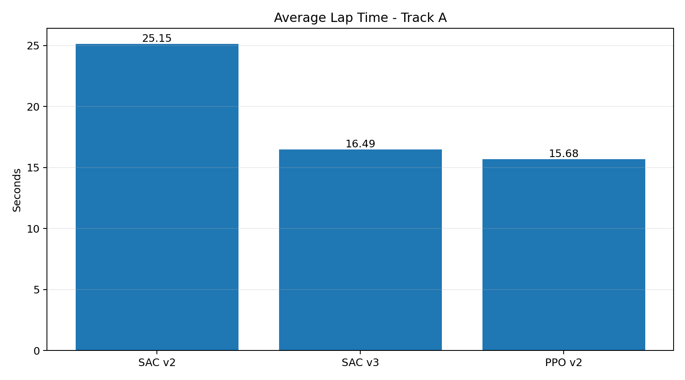
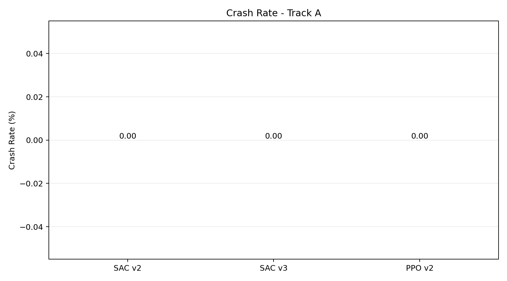
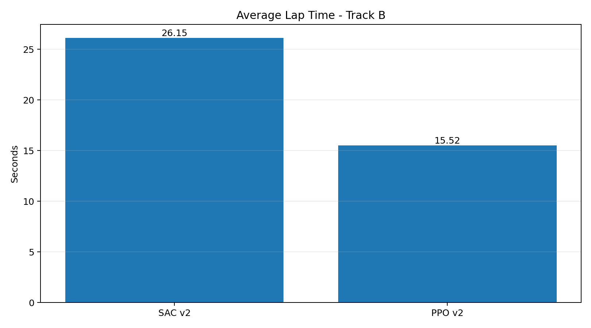
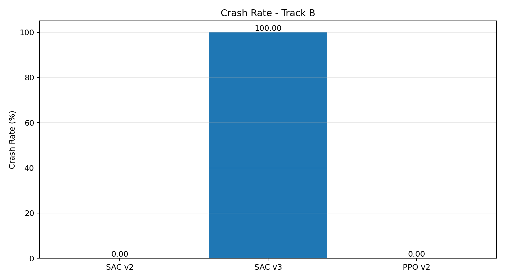

# Reinforcement Learning-Based Autonomous Racing Simulator

A custom 2D autonomous racing simulator built using **Pygame** and **Gymnasium**, featuring autonomous driving agents trained using **Soft Actor-Critic (SAC)** and **Proximal Policy Optimization (PPO)**.

The project explores autonomous vehicle control through simulated LiDAR perception, continuous steering and throttle/braking actions, and reinforcement learning. Agents are evaluated across multiple racing circuits to study driving performance and cross-track generalization.

## Features

- Custom 2D racing simulator with two distinct racing circuits.
- Simulated LiDAR-based track perception using 11 distance sensors.
- Continuous steering and throttle/braking control.
- Gymnasium-compatible reinforcement learning environment.
- SAC and PPO agent training using Stable-Baselines3.
- Deterministic agent evaluation across multiple tracks.
- Head-to-head racing between trained agents.
- Performance benchmarking and visualization.

## System Architecture

```text
          Racing Simulator
          (Pygame + Physics)
                  |
                  v
          Simulated LiDAR
             (11 Rays)
                  |
                  v
           Observation Space
          (11 LiDAR + Speed)
                  |
                  v
        Reinforcement Learning
             Agent (SAC/PPO)
                  |
                  v
            Action Space
       (Steering + Throttle)
                  |
                  v
          Vehicle Controller
                  |
                  v
          Racing Simulator
                  |
                  v
        Reward and Evaluation
```

## Technologies Used

- **Languages:** Python
- **Simulation:** Pygame
- **Reinforcement Learning:** Stable-Baselines3, Gymnasium
- **Algorithms:** SAC, PPO
- **Numerical Computing:** NumPy
- **Visualization:** Matplotlib


## Benchmark Results

Each agent was evaluated over 10 episodes on both racing circuits.

| Algorithm | Track | Avg. Lap Time | Fastest Lap | Crash Rate | Completed Laps |
|---|---|---:|---:|---:|---:|
| SAC v2 | A | 25.15 s | 24.62 s | 0% | 30 |
| SAC v2 | B | 26.15 s | 25.52 s | 0% | 30 |
| SAC v3 | A | 16.49 s | 16.07 s | 0% | 50 |
| SAC v3 | B | N/A | N/A | 100% | 0 |
| PPO v2 | A | 15.68 s | 15.50 s | 0% | 50 |
| PPO v2 | B | 15.52 s | 15.37 s | 0% | 50 |

### Observations

- **PPO v2:** Achieved the most consistent performance across both tracks, completing 50 laps on each with zero crashes.
- **SAC v3:** Demonstrated substantial improvement on Track A compared with SAC v2, but failed to generalize to Track B.
- **SAC v2:** Completed laps on both tracks without crashing, but recorded slower lap times than PPO v2.
- **Cross-track generalization:** The results highlight the importance of evaluating reinforcement learning agents on tracks beyond their training environment.

## Performance Visualization

### Track A





### Track B



